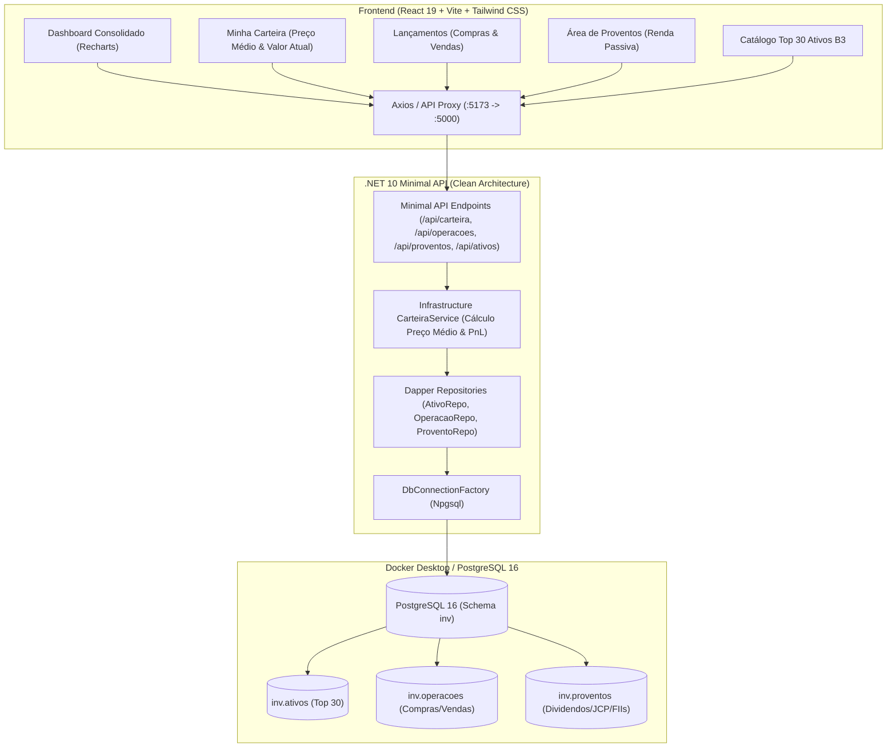

# 📈 InvestirGo — Gestão de Investimentos, Preço Médio e Proventos (B3 & FIIs)

Plataforma completa de controle patrimonial para investidores em **Ações** e **Fundos Imobiliários (FIIs)** da bolsa brasileira (B3). Construída seguindo rigorosamente a **Clean Architecture** do projeto de referência `peca-aki`, utilizando **.NET 10 Minimal API**, **PostgreSQL** com **Dapper**, e **Frontend React 19 + Vite + Tailwind CSS**.

---

## 🚀 Funcionalidades Principais

1. **Cálculo Preciso de Preço Médio**:
   - Atualização ponderada automática do Preço Médio a cada operação de compra:
     $$PM = \frac{(Q_{atual} \times PM_{atual}) + (Q_{compra} \times P_{compra})}{Q_{atual} + Q_{compra}}$$
   - Manutenção do preço médio e apuração de lucro/prejuízo realizado nas vendas.
2. **Valor Investido vs. Cotação Atual (A Mercado)**:
   - Visualização lado a lado do total desembolsado e do saldo a mercado atualizado.
   - Rentabilidade percentual e variação em R$ por ativo e consolidada na carteira.
3. **Área Exclusiva de Proventos**:
   - Registro e acompanhamento de **Dividendos**, **JCP (Juros sobre Capital Próprio)**, **Rendimentos de FIIs** e **Amortizações**.
   - Gráfico de evolução mensal da renda passiva recebida.
   - Cálculo do retorno total líquido somando proventos e valorização.
4. **Top 30 Melhores Ativos Pré-Carregados**:
   - 15 maiores empresas da B3 (PETR4, VALE3, ITUB4, BBAS3, BBDC4, TAEE4, TAEE11, ITSA4, SANB4, POMO4, BBDC3, WEGE3, ABEV3, RENT3, PRIO3).
   - 15 principais Fundos Imobiliários (MXRF11, HGLG11, XPML11, KNIP11, KNCR11, BTLG11, VISC11, HGRU11, CPTS11, VGHF11, TGAR11, KNHY11, XPLG11, TRXF11, ALZR11).
   - Edição rápida de cotação para simulação em tempo real de oscilações da carteira.
5. **Histórico da Sua Planilha Pré-Carregado**:
   - Todas as 18 operações fornecidas como exemplo já vêm migradas e computadas no banco de dados.

---

## 🏛️ Arquitetura do Sistema



---

## 📁 Estrutura do Repositório

```text
investir-go/
├── database/
│   ├── docker-compose.yml       # Configuração do PostgreSQL para Docker Desktop
│   └── init.sql                 # DDL do schema 'inv' + Seed dos 30 ativos e 18 operações
│
├── backend/                     # Backend .NET 10 (Clean Architecture padrão peca-aki)
│   ├── InvestirGo.slnx          # Solução .NET 10
│   └── src/
│       ├── Domain/
│       │   └── Entities/        # Ativo, Operacao, Provento, PosicaoCarteira, ResumoCarteira
│       ├── Application/
│       │   ├── DTOs/            # CriarOperacaoDto, CriarProventoDto, AtualizarCotacaoDto
│       │   └── Interfaces/      # IAtivoRepository, IOperacaoRepository, IProventoRepository, ICarteiraService
│       ├── Infrastructure/
│       │   ├── Data/            # DbConnectionFactory (Npgsql)
│       │   ├── Repositories/    # AtivoRepository, OperacaoRepository, ProventoRepository (Dapper)
│       │   └── Services/        # CarteiraService (Cálculo de Preço Médio e Rentabilidade)
│       ├── API/
│       │   └── Endpoints/       # Endpoints Minimal API (Mapeamento /api/...)
│       ├── Program.cs           # Bootstrap, Serilog, CORS, Swagger OpenAPI
│       └── appsettings.json     # ConnectionStrings do PostgreSQL
│
└── frontend/                    # Frontend React 19 + TypeScript + Vite + Tailwind
    ├── src/
    │   ├── components/          # Navbar, DashboardTab, CarteiraTab, OperacoesTab, ProventosTab, MercadoTab, Modais
    │   ├── services/            # api.ts (Cliente Axios)
    │   ├── types/               # Tipos TypeScript
    │   ├── App.tsx              # Componente Raiz e Gestão de Estado
    │   └── main.tsx             # Entrypoint Vite
    ├── package.json
    ├── vite.config.ts
    └── tailwind.config.js
```

---

## ⚡ Como Executar o Projeto

### 1. Iniciar o Banco de Dados (Docker Desktop)
No terminal, execute:
```bash
docker compose -f database/docker-compose.yml up -d
```
> O container `investir-db` será iniciado na porta `5432` com usuário `admin` e banco `investir_db`. O script `database/init.sql` carrega automaticamente o schema e os 30 ativos.

### 2. Iniciar o Backend (.NET 10)
```bash
cd backend/src
dotnet run
```
A API iniciará em `http://localhost:5000` (documentação Swagger disponível em `http://localhost:5000/swagger`).

### 3. Iniciar o Frontend (React + Vite)
Em outro terminal:
```bash
cd frontend
npm run dev
```
Acesse a aplicação no navegador em `http://localhost:5173`.
