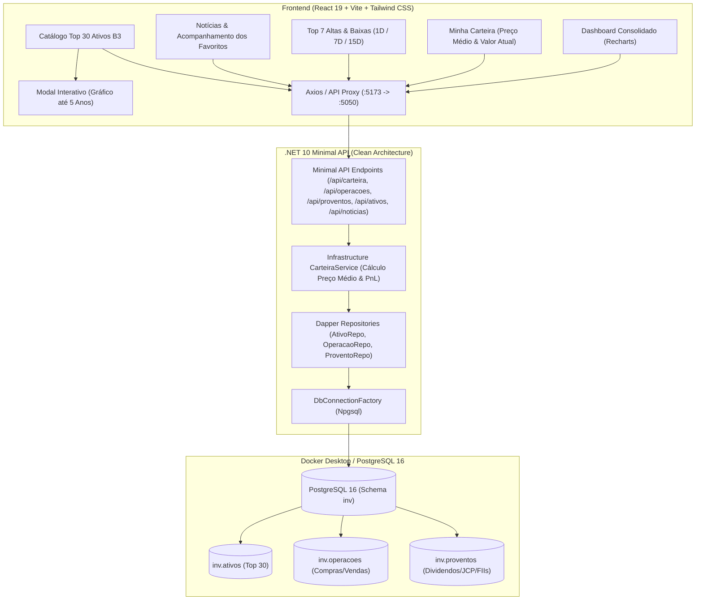

# 📈 InvestirGo — Gestão de Investimentos, Preço Médio, Proventos & Cotações (B3 & FIIs)

Plataforma completa de controle patrimonial para investidores em **Ações** e **Fundos Imobiliários (FIIs)** da bolsa brasileira (B3). Construída seguindo rigorosamente a **Clean Architecture** do projeto de referência `peca-aki`, utilizando **.NET 10 Minimal API**, **PostgreSQL** com **Dapper**, e **Frontend React 19 + Vite + Tailwind CSS**.

---

## 🚀 Funcionalidades Principais

1. **Top 30 Ativos com Modal e Gráfico Histórico de até 5 Anos**:
   - Clique em qualquer ativo do catálogo para abrir o modal de análise interativa.
   - Consulta de múltiplos períodos: **1D (Hoje)**, **7D**, **15D**, **1M**, **6M**, **1A**, **2A** e **5A (5 Anos)**.
   - Indicador visual claro do quanto o ativo subiu ou caiu em percentual (%) e em reais (R$), com mínima, máxima e preço médio.
   - Gráfico de área suave (*Recharts*) com gradientes dinâmicos (verde em alta / vermelho em baixa) e tooltips com data legível e variação acumulada.
   - Botão para favoritar e ação direta para comprar cotas.

2. **Top 7 Maiores Altas & Top 7 Maiores Baixas (Página Exclusiva de Performance)**:
   - Visualização dedicada dos 7 ativos que mais renderam e dos 7 que menos performaram.
   - Seleção ágil entre os períodos: **No Dia (1D)**, **7 Dias (Semanal)** e **15 Dias (Quinzenal)**.
   - Filtros por classe de ativo: *Todos*, *Apenas Ações* ou *Apenas FIIs*.
   - Destaques automáticos: ativo campeão do período, ativo mais pressionado e média de rendimento da bolsa.
   - Badges de pódio com medalhas (🥇 1º Ouro, 🥈 2º Prata, 🥉 3º Bronze) e barras visuais de magnitude.

3. **Área de Acompanhamento Diário: Notícias Recentes & Ativos Favoritos**:
   - Sistema de favoritos persistente via *localStorage*, sincronizado em toda a aplicação.
   - Feed de notícias e fatos relevantes em tempo real, filtrados pelos ativos que o investidor favoritou.
   - Seletor de visualização: *Meus Favoritos*, *Ativo específico* ou *Todas as notícias do mercado*.
   - Tags por categoria (*Proventos*, *Fatos Relevantes*, *Resultados*, *Análises*) e impacto de mercado (*Positivo*, *Neutro*, *Atenção*).
   - Modal para leitura rápida e aprofundada de comunicados.

4. **Cálculo Preciso de Preço Médio e PnL**:
   - Atualização ponderada automática do Preço Médio a cada operação de compra:
     $$PM = \frac{(Q_{atual} \times PM_{atual}) + (Q_{compra} \times P_{compra})}{Q_{atual} + Q_{compra}}$$
   - Manutenção do preço médio e apuração de lucro/prejuízo realizado nas vendas.
   - Rentabilidade percentual e variação em R$ por ativo e consolidada na carteira.

5. **Área Exclusiva de Proventos**:
   - Registro e acompanhamento de **Dividendos**, **JCP (Juros sobre Capital Próprio)**, **Rendimentos de FIIs** e **Amortizações**.
   - Gráficos de evolução mensal da renda passiva e retorno total líquido.

6. **Fluxo Reorganizado em Páginas Separadas e Amigáveis**:
   - 📊 **Dashboard Consolidado**: Resumo patrimonial, gráficos de alocação e proventos.
   - 💼 **Minha Carteira**: Posições em custódia, preço médio, cotação a mercado e rentabilidade individual.
   - 🏆 **Altas & Baixas (Ranking)**: Top 7 que mais renderam e Top 7 que menos performaram (1D, 7D, 15D).
   - 📈 **Top 30 Mercado**: Catálogo completo com clique interativo para modal de 5 anos e edição rápida de cotações.
   - ⭐ **Notícias & Favoritos**: Hub diário com resumo dos favoritos e feed de notícias financeiras.
   - 🪙 **Proventos**: Extrato detalhado de dividendos e rendimentos.
   - 📝 **Lançamentos**: Histórico de ordens de compra e venda.

---

## 🏛️ Arquitetura do Sistema



---

## 📁 Estrutura do Repositório

```text
investir-go/
├── database/
│   ├── docker-compose.yml       # Configuração do PostgreSQL para Docker Desktop
│   └── init.sql                 # DDL do schema 'inv' + catálogo inicial de ativos
│
├── backend/                     # Backend .NET 10 (Clean Architecture padrão peca-aki)
│   ├── InvestirGo.slnx          # Solução .NET 10
│   └── src/
│       ├── Domain/
│       │   └── Entities/        # Ativo, Operacao, Provento, PosicaoCarteira, ResumoCarteira
│       ├── Application/
│       │   ├── DTOs/            # DTOs de Operações, Proventos, Histórico, Performance e Notícias
│       │   └── Interfaces/      # IAtivoRepository, IOperacaoRepository, IProventoRepository, ICarteiraService
│       ├── Infrastructure/
│       │   ├── Data/            # DbConnectionFactory (Npgsql)
│       │   ├── Repositories/    # AtivoRepository, OperacaoRepository, ProventoRepository (com fallback resiliente)
│       │   └── Services/        # CarteiraService (Cálculo de Preço Médio e Rentabilidade)
│       ├── API/
│       │   └── Endpoints/       # Endpoints Minimal API (Mapeamento /api/...)
│       ├── Program.cs           # Bootstrap, Serilog, CORS, Swagger OpenAPI
│       └── appsettings.json     # ConnectionStrings do PostgreSQL
│
└── frontend/                    # Frontend React 19 + TypeScript + Vite + Tailwind
    ├── src/
    │   ├── components/
    │   │   ├── Navbar.tsx               # Barra de navegação com contador de favoritos e abas
    │   │   ├── AtivoDetalhesModal.tsx   # Modal de 5 anos com gráfico, variação % e R$, mínima e máxima
    │   │   ├── PerformanceTab.tsx       # Página dedicada: Top 7 Maiores Altas e Baixas (1D, 7D, 15D)
    │   │   ├── NoticiasFavoritosTab.tsx # Página dedicada: Hub diário de notícias dos ativos favoritos
    │   │   ├── MercadoTab.tsx           # Catálogo Top 30 com clique para modal e favoritar
    │   │   ├── CarteiraTab.tsx          # Posições, Preço Médio e Valor a Mercado
    │   │   ├── DashboardTab.tsx         # Dashboard Consolidado
    │   │   ├── OperacoesTab.tsx         # Lançamentos de Compras e Vendas
    │   │   └── ProventosTab.tsx         # Extrato e gráficos de proventos
    │   ├── utils/
    │   │   └── marketData.ts    # Motor de histórico até 5 anos, rankings de performance e notícias
    │   ├── services/
    │   │   └── api.ts           # Cliente Axios com fallback resiliente
    │   ├── types/
    │   │   └── index.ts         # Tipos TypeScript para todas as entidades
    │   ├── App.tsx              # Componente Raiz com gestão de estado e sincronização
    │   └── main.tsx             # Entrypoint Vite
    ├── package.json
    ├── vite.config.ts           # Configuração de proxy para :5050
    └── tailwind.config.js
```

---

## ⚡ Como Executar o Projeto

### 1. Iniciar o Banco de Dados (Docker Desktop - Opcional)
```bash
docker compose -f database/docker-compose.yml up -d
```
> O container `investir-db` será iniciado na porta `5432` com usuário `admin` e banco `investir_db`. O script `database/init.sql` carrega automaticamente o schema e os 30 ativos.
> *(Nota: Tanto a API quanto o Frontend contam com modo de contingência/resiliência com dados pré-carregados, funcionando mesmo se o Docker estiver desligado).*

### 2. Iniciar o Backend (.NET 10)
```bash
cd backend/src
dotnet run
```
A API iniciará em `http://localhost:5050` (documentação Swagger disponível em `http://localhost:5050/swagger`).

### 3. Iniciar o Frontend (React + Vite)
Em outro terminal:
```bash
cd frontend
npm run dev
```
Acesse a aplicação no navegador em `http://localhost:5173`.
